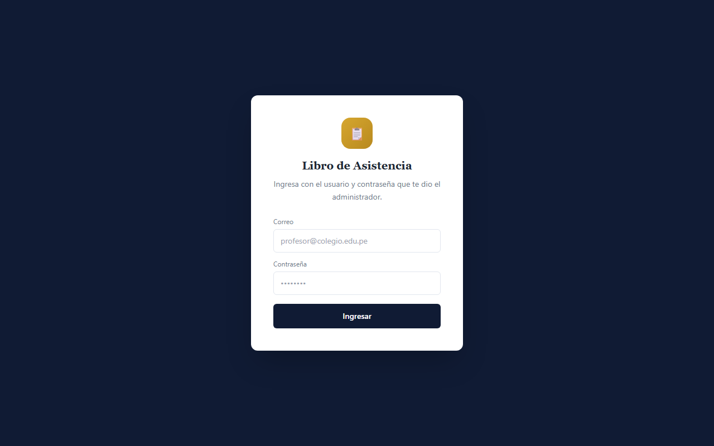

# 📋 Libro de Asistencia

[](https://github.com/FernandoJose25/libro-asistencia-web/actions/workflows/ci.yml)


App web para que los profesores **tomen asistencia, registren notas y detecten alumnos en riesgo por faltas**, trabajando directamente sobre su **Google Drive**. Está en producción: **[demo](https://libro-asistencia-web.vercel.app)** (el acceso es con cuentas que crea el administrador).

> **English summary:** Attendance and grade book web app for teachers, in production. Next.js 14 App Router with server route handlers, Supabase (Postgres + RLS + SQL views) for structured attendance records, and a full Google Drive integration via OAuth 2.0 with stored refresh tokens: teachers browse, upload, move and edit their real Drive files and turn any spreadsheet into an attendance group that syncs back to Drive. Includes Excel/PDF exports, attendance heatmaps, absence-risk detection and AI summaries (Groq).



## Mi rol

Desarrollo completo hecho por mí (48 commits): relevamiento con profesores, modelo de datos, backend, integración con Google, interfaz y despliegue.

## Qué hace

- **Asistencia por grupo:** asistió, tardanza, faltó o justificada (con motivo), horas por día y guardado automático.
- **Riesgo por inasistencias:** se calcula sobre las faltas permitidas del curso con una vista SQL, para alertar a tiempo.
- **Calificaciones:** evaluaciones por grupo y notas por alumno.
- **Mapa de calor** de la asistencia, mini calendario y reporte por alumno.
- **Resumen con IA** de la asistencia del grupo (Groq, LLaMA 3.1).
- **Explorador completo de Google Drive** dentro de la app: navegar, buscar, subir, crear carpetas, renombrar, mover, copiar, borrar y descargar.
- **Cualquier hoja de cálculo de Drive** (xlsx, csv o Google Sheets) se convierte en un grupo con un clic. "Sincronizar ahora" guarda en Supabase y reescribe el archivo en Drive.
- **Importar alumnos desde Excel** y **exportar** la asistencia y los reportes a Excel o PDF.
- **Cuentas gestionadas por el administrador** (sin registro público). El token de Drive se guarda una vez y se renueva solo.

## Stack

| Capa | Tecnologías |
|---|---|
| Frontend | Next.js 14 (App Router), React 18, TypeScript, Tailwind CSS |
| Backend | Route Handlers de Next.js (17 endpoints: Drive, grupos, sincronización) |
| Base de datos | Supabase: PostgreSQL, Row Level Security, vistas SQL, 9 migraciones |
| Integraciones | Google Drive API (`googleapis`) con OAuth 2.0 propio y refresh tokens · Groq (IA) · SheetJS (`xlsx`) |
| Despliegue | Vercel |

## Arquitectura

```
app/login                      Login con email y contraseña (Supabase Auth)
app/dashboard/                 Resumen, grupos, asistencia, alumnos, Drive y conexión de Drive
app/api/google/                Flujo OAuth: connect → callback (guarda el refresh_token con RLS)
app/api/drive/                 browse, search, upload, rename, move, copy, delete, download…
app/api/asistencia/sync        Sincroniza Supabase ↔ archivo de Drive
lib/googleAuth.ts              URL de consentimiento y renovación del access_token
lib/drive.ts                   Operaciones sobre Drive
supabase/                      schema.sql + migraciones 001–009
```

## Correr el proyecto

```bash
cp .env.example .env.local   # Supabase, Google OAuth y Groq
npm install
npm run dev                  # http://localhost:3000
npm run build                # build de producción (compila también sin .env)
```

La guía paso a paso para configurar Supabase, Google Cloud y Vercel está en **[docs/SETUP.md](docs/SETUP.md)**.
